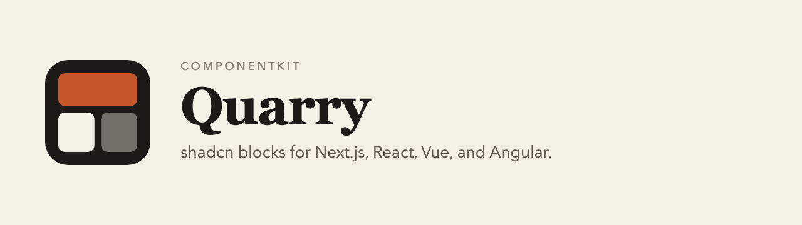

# Quarry

shadcn blocks for Next.js, React, Vue, and Angular. Preview a layout, then copy the source into the project you are already building.

**[quarry.bitscorp.co](https://quarry.bitscorp.co)**

## What you get

- 75 blocks across marketing sections and application frames.
- Source for Next.js, React, Vue, and Angular. The live preview is React. Vue and Angular are copy-paste files.
- Theme token names that match shadcn/ui, so a pasted block sits in a project that already uses that setup.
- A shadcn registry at `https://quarry.bitscorp.co/r/{name}.json`. Demo blocks are open. The rest of the library needs a seat.

Quarry is not affiliated with shadcn/ui, and it does not ship a component package. There is no Quarry runtime. After you paste a file, it is yours to edit.

## Access

The library is **$20.99 once**. A fixed demo set stays open so you can preview and copy before you pay.

Sign in with Google, or with email and a password. The seat stays on that account.

## Start

- [Browse the blocks](https://quarry.bitscorp.co/blocks)
- [Read the docs](https://quarry.bitscorp.co/docs)
- [Pricing](https://quarry.bitscorp.co/pricing)
- [Changelog](https://quarry.bitscorp.co/changelog)
- [Agent map](https://quarry.bitscorp.co/llms.txt)

This repository is the public home of Quarry. The catalog source is not published here.
